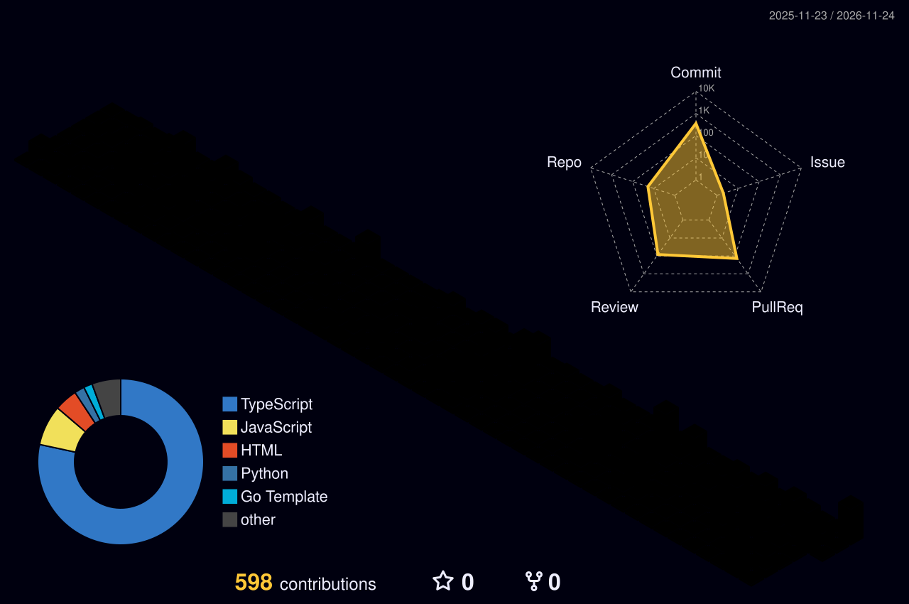

# Hi 👋, I'm Liran Tul

 

---

## 🛠️ Tech Stack

  

---

## 📊 Stats

  

---

## 📈 Activity

  

---

## 🌐 3D Contributions

  

---

## 📐 Isometric Calendar

  

---

## 🐍 Contributions

  <picture>
    <source media="(prefers-color-scheme: dark)" srcset="https://raw.githubusercontent.com/lirantul123/lirantul123/output/github-contribution-grid-snake-dark.svg">
    
  </picture>

